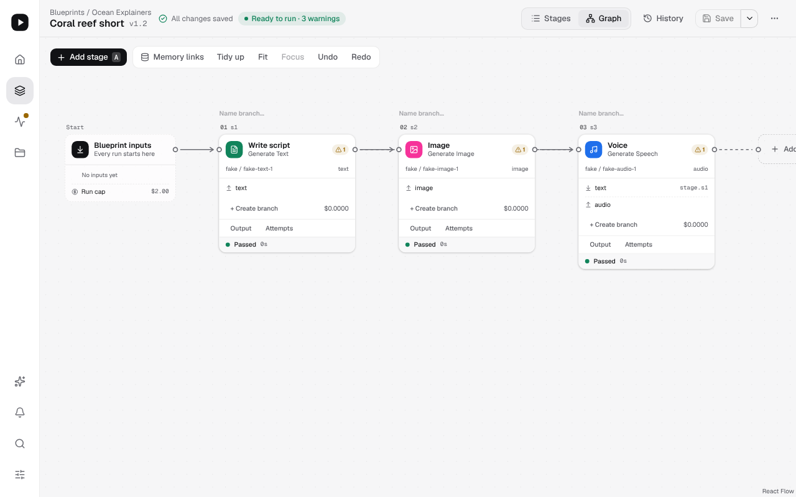

# Reelcraft

[](https://github.com/napstar-420/reelcraft/actions/workflows/ci.yml)
[](https://github.com/napstar-420/reelcraft/actions/workflows/docs.yml)
[](https://github.com/napstar-420/reelcraft/actions/workflows/release.yml)

**Self-hosted, provider-agnostic AI video automation with reusable blueprints, human approval gates, and per-run spend caps — no manual editing.**

Reelcraft makes AI videos and reels from a recipe you build once and run as often as you like. It runs
on your own machine as a single Docker container, and you use it in your browser. You pick which AI
services do the work, including your existing ChatGPT or Claude plan, and every run has a spending cap.

**New here? Read the [user guide](https://napstar-420.github.io/reelcraft/docs/).** It takes you from nothing
installed to a working Reelcraft, and you never need the source code.



## Contents

- [Made with Reelcraft](#made-with-reelcraft)
- [Why Reelcraft](#why-reelcraft)
- [Quick start](#quick-start)
- [How it compares](#how-it-compares)
- [How it works](#how-it-works)
- [Supported providers](#supported-providers)
- [Who this is for](#who-this-is-for)
- [Known limitations](#known-limitations)
- [Roadmap](#roadmap)
- [Develop it](#develop-it)
- [Docs and links](#docs-and-links)

## Made with Reelcraft

<!--
  DEMO GIF HERE — MAINTAINER TODO

  A short demo GIF or video is the single highest-impact addition to this README. Visitors decide in
  seconds whether a video tool is worth trying, and a screenshot of a canvas does not show output.

  What to add:
  1. A 10-20 second GIF (or an MP4 uploaded to a GitHub issue/PR comment and linked here) showing
     one blueprint going from "Start run" to a finished video.
  2. Two or three finished videos produced by real runs, with a one-line description of the blueprint
     behind each (stages used, providers used, rough cost).
  3. Replace the placeholder list below. Do not list anything here that Reelcraft did not make.

  Example markup once you have the file:
    
-->

> Demo coming soon. This section is a placeholder for the maintainer to fill in.

- _Example 1: title, what the blueprint does, providers used, cost per video_ <!-- TODO: add -->
- _Example 2: title, what the blueprint does, providers used, cost per video_ <!-- TODO: add -->
- _Example 3: title, what the blueprint does, providers used, cost per video_ <!-- TODO: add -->

## Why Reelcraft

- **Free to start.** A built-in fake provider produces placeholder results with no API keys, so you can
  build and test a whole blueprint for $0.
- **Bring your own keys, or your existing plan.** Use API keys for OpenRouter, fal, ElevenLabs and
  Deepgram, or route text work through a ChatGPT or Claude subscription you already pay for, using
  BrowserOS Neo, Codex or Claude, instead of per-token billing.
- **Free local voice.** VoiceStudio (free voice-over, voice cloning and captions) and Qwen3-TTS (free
  local voices) run on your own computer.
- **Reusable blueprints with a visual canvas.** Build the recipe once, as a graph of stages, and run it
  for every video. Each stage can use what earlier stages made.
- **Batch generation.** The iterate stage loops over a list and makes one video per item.
- **Humans stay in the loop.** Approve or fix a stage mid-run. Quality checks (sandboxed QuickJS checks
  and semantic retry loops) catch bad output before it reaches the next stage.
- **Spend caps that hold.** Every run has a budget. The budget ledger uses row-level locks, so parallel
  stages cannot overspend it, and money is stored as exact decimals.
- **Provider-agnostic.** Stages ask for a capability, such as `text.generate`, and Reelcraft picks a
  provider that offers it. Swapping a provider does not mean rebuilding your blueprint.
- **Characters that matter.** Characters on a channel feed generation, not just metadata.
- **Self-hosted and private.** Your channels, assets and runs stay on your machine. The in-app updater
  installs signed releases.

## Quick start

No developer tools and no source checkout. You need Docker.

```bash
docker run -d --name reelcraft --restart unless-stopped \
  -p 127.0.0.1:8080:8080 -v reelcraft-data:/data zohaibkhan97/reelcraft
```

Then open <http://localhost:8080>. The image contains the app, Postgres, MinIO file storage and Inngest.
Your data lives in the `reelcraft-data` volume.

- **Keep it on this computer.** `127.0.0.1:` in the command above publishes the port only on your own
  computer. Because Reelcraft has no login, drop it (`-p 8080:8080`) only to reach Reelcraft from another
  device on a network you trust.
- **Linux with Docker Engine** (not Docker Desktop): add `--add-host=host.docker.internal:host-gateway`
  so the container can resolve your computer's address. A service on your computer must also listen on
  an address the container can reach, not only `127.0.0.1`. VoiceStudio, for example, needs
  `OMNIVOICE_BIND_HOST=0.0.0.0` and an API key; see its [guide](https://napstar-420.github.io/reelcraft/docs/voice-studio).

**Try it free first.** Create a channel, add a blueprint and start a run. The default is the fake
provider, so it costs nothing and needs no API keys. Add real providers later in **Settings**.

**What you need**

- A 64-bit computer running Windows 10 or 11, macOS (Apple Silicon or Intel), or Linux.
- 8 GB of memory (Docker should be allowed at least 4 GB).
- About 10 GB of free disk space. The local Qwen3-TTS voices add roughly 4 to 6 GB, downloaded on demand.
- Docker Desktop (free for personal use), or Docker Engine on Linux.

Step-by-step instructions with screenshots are in the [user guide](https://napstar-420.github.io/reelcraft/docs/).

> [!WARNING]
> **Reelcraft has no login.** Anyone who can reach port 8080 can use your channels and spend your
> provider credits. Run it only on a trusted machine, and never expose it to the
> internet.

## How it compares

A factual snapshot, not a ranking. The hosted tools below are good at what they do; the question is
whether you want a hosted product or a system you run yourself.

|                                  | Reelcraft                                                         | Hosted prompt-to-video tools (InVideo, HeyGen, Synthesia) | DIY automation (n8n workflows)                                   |
| -------------------------------- | ----------------------------------------------------------------- | --------------------------------------------------------- | ---------------------------------------------------------------- |
| Self-hosted                      | Yes, one Docker container                                         | No, hosted service                                        | Yes, or hosted                                                   |
| Choose your AI providers         | Yes, via adapters                                                 | Fixed by the vendor                                       | Yes, you wire each one                                           |
| Use your own ChatGPT/Claude plan | Yes (BrowserOS Neo, Codex, Claude)                                | No                                                        | Not built in                                                     |
| Reusable video recipes           | Yes, blueprints with a visual canvas                              | Templates and projects                                    | Workflows you build and maintain                                 |
| Human approval mid-run           | Yes, built in                                                     | Editing in the vendor's editor                            | You build it                                                     |
| Per-run spend caps               | Yes, concurrency-safe ledger                                      | Plan-based credits or limits                              | You build it                                                     |
| Free to start                    | Yes, fake provider, no keys                                       | Varies by vendor <!-- TODO: verify -->                    | The software is free; providers are not                          |
| Open source                      | Open core (see [Roadmap](#roadmap)) <!-- TODO: verify license --> | No                                                        | n8n is source-available; check its license <!-- TODO: verify --> |

## How it works

Three ideas cover the whole product:

- **Channel**: a show or account you make videos for. It holds your characters, assets and default settings.
- **Blueprint**: the recipe. A list of **stages** that run in order, or side by side when they don't need
  each other, such as write a script, make images, record a voice-over, put the video together. Each
  stage can use what the stages before it made. You build blueprints on a **visual canvas**, can start
  from a template, and every save keeps a numbered version.
- **Run**: one video made from a blueprint version, with its own inputs. You watch live progress, approve
  or fix a stage half-way through, edit the timeline by hand, and download the result. Each run has its
  own spend cap.

An **iterate** stage loops over a list and runs part of the blueprint once per item, which is how you
batch-generate videos.

The built-in **assistant** is a chat on every page that can author and edit blueprints, start runs and
look into failures. It runs on Codex or Claude. Using it is optional: you can always create and edit
blueprints, stages and timelines by hand, and that is a first-class way to work.

See [How Reelcraft works](https://napstar-420.github.io/reelcraft/docs/concepts/how-it-works) in the guide.

## Supported providers

Providers connect through adapters. Stages ask for a capability, and Reelcraft picks a provider that has it.

<!-- TODO: verify — maintainer to confirm which providers have been checked against the real service end to end. -->

### Verified

| Provider      | Used for                                                                      | Cost               | Setup                                                               |
| ------------- | ----------------------------------------------------------------------------- | ------------------ | ------------------------------------------------------------------- |
| Fake provider | Placeholder text, images, audio and video for building and testing blueprints | **Free**, no keys  | Built in                                                            |
| BrowserOS Neo | Using your ChatGPT plan in a browser on your computer                         | Your existing plan | [Guide](https://napstar-420.github.io/reelcraft/docs/browseros-neo) |
| Codex         | Using your ChatGPT plan through OpenAI's Codex                                | Your existing plan | [Guide](https://napstar-420.github.io/reelcraft/docs/codex)         |
| Claude        | Using your Claude plan through Anthropic's Claude Code                        | Your existing plan | [Guide](https://napstar-420.github.io/reelcraft/docs/claude-code)   |

### Experimental

Implemented and covered by tests, but real-money runs are only partly verified. Set a low per-run cap
the first time you use one.

| Provider    | Used for                                                      | Cost                   | Setup                                                               |
| ----------- | ------------------------------------------------------------- | ---------------------- | ------------------------------------------------------------------- |
| OpenRouter  | Text and image models from many vendors, through one key      | Pay per use            | [Guide](https://napstar-420.github.io/reelcraft/docs/provider-keys) |
| fal         | Image and video generation                                    | Pay per use            | [Guide](https://napstar-420.github.io/reelcraft/docs/provider-keys) |
| ElevenLabs  | Voice-over (text to speech)                                   | Pay per use            | [Guide](https://napstar-420.github.io/reelcraft/docs/provider-keys) |
| Deepgram    | Voice-over, transcription and captions                        | Pay per use            | [Guide](https://napstar-420.github.io/reelcraft/docs/provider-keys) |
| VoiceStudio | Voice-over, voice cloning and captions on your computer       | **Free**, runs locally | [Guide](https://napstar-420.github.io/reelcraft/docs/voice-studio)  |
| Qwen3-TTS   | Local voice-over; model downloads on demand (about 4 to 6 GB) | **Free**, runs locally | [Guide](https://napstar-420.github.io/reelcraft/docs/qwen-tts)      |

The subscription routes (BrowserOS Neo, Codex, Claude) let you use a plan you already have instead of
paying per token. Which stage types each one covers differs, so check its guide page.

## Who this is for

- **Solo creator running a channel.** You want a repeatable way to make faceless or AI-assisted videos
  without learning an editor. Build the blueprint once, keep your characters and assets in a channel,
  approve the steps that matter, and cap what each video can cost.
- **Developer or automation builder.** You want control over providers, prompts and checks, and open
  provider adapters instead of a closed product. You run it on your own infrastructure.
- **Agency or team producing at volume.** You want the same recipe applied to many videos. Use the
  iterate stage for batches, share blueprints as signed `.reelpack` files, and use spend caps so a bad
  prompt cannot run up a bill.

## Known limitations

> [!WARNING]
> **There is no login or user accounts.** Keep Reelcraft on a trusted machine or a private network, and
> never expose its port to the internet. Anyone who can open it can use it.

- **Provider coverage is uneven.** Real-money runs against every provider are only partly verified. See
  [Supported providers](#supported-providers) for which are Verified and which are Experimental.
- **Live updates are hints, not data.** The browser follows runs and the assistant over a Socket.IO
  connection that tells it when to refetch from the REST API. The event bus lives in the API process,
  so it assumes one API instance, which is how the Docker image runs.
- **Local voices are heavy.** Qwen3-TTS downloads about 4 to 6 GB on first use and needs more memory
  than the base requirements.

## Roadmap

Direction, not a promise or a schedule.

- **Assistant as a blueprint author.** Go deeper on authoring, editing and reviewing blueprints. Manual
  editing stays.
- **Reelcraft Cloud.** A hosted version, planned.
- **Blueprint marketplace.** A free gallery first, with paid creator subscriptions later on Cloud.

Reelcraft is open core: the engine, the self-hosted image and the provider adapters are open, and the
hosted Cloud and marketplace are separate. <!-- TODO: verify license and add a LICENSE file; none is in the repo today -->

## Develop it

This part is for contributors. You do not need any of it to use Reelcraft.

### Set up

You need Node.js 22+, pnpm 9 and Docker.

```bash
cp .env.example .env
docker compose up -d      # Postgres, MinIO (file storage) and Inngest (background jobs)
pnpm install
pnpm db:migrate
pnpm dev                  # API on :3000, web app on :5173
```

Open <http://localhost:5173>. The default provider is the fake one, so it costs nothing and needs no
API keys. Never put provider keys in code, fixtures or commits.

### Repo map

| Path                            | What is in it                                                                      |
| ------------------------------- | ---------------------------------------------------------------------------------- |
| `apps/api`                      | The backend (NestJS): REST and live-event API, database schema, background jobs    |
| `apps/web`                      | The web app (React + Vite): channels, the blueprint canvas, runs, timeline editor  |
| `apps/render-worker`            | Renders the final video with Remotion                                              |
| `apps/docs`                     | The user guide (Docusaurus), published to GitHub Pages. Not in the pnpm workspace  |
| `packages/shared`               | Zod schemas and types shared by the API and web app. The source of truth for shape |
| `packages/timeline-composition` | The Remotion composition used for both the editor preview and the final render     |
| `docker/app`                    | The self-hosted image: Dockerfile, services, in-app updater                        |
| `scripts/release`               | Release manifest building and signing                                              |
| `docs/`                         | Design spec, decision records, self-hosting notes, development notes               |

### Commands

```bash
pnpm dev              # API and web app together
pnpm typecheck        # TypeScript across the whole repo
pnpm lint             # ESLint
pnpm format:check     # Prettier (pnpm format fixes)
pnpm test             # unit tests: shared, API, web
pnpm test:e2e         # API end-to-end tests; need Postgres from docker compose
pnpm test:release     # release signing and updater tests
pnpm db:generate      # create a migration after changing the schema
pnpm db:migrate       # apply migrations
```

Run one API test file: `pnpm --filter @reelcraft/api test -- path/to/file.test.ts`.

### How it fits together

- The **web app** talks to the **API** over REST, and follows runs live through Socket.IO
  ([ADR-0010](docs/adr/0010-live-updates-over-socket-io.md)).
- Starting a run does not run it inside the request. The API writes the action to Postgres, and
  **Inngest** (a job runner that survives restarts) carries the run through its stages one by one.
- Stages call AI **providers** through adapters (OpenRouter, fal, ElevenLabs, Deepgram, VoiceStudio,
  Qwen3-TTS, BrowserOS Neo, Codex, Claude, and the fake one). Provider keys are read through
  `KEY_PROVIDER`: the environment first, then keys saved in **Settings**.
- Generated files go to **MinIO**, an S3-compatible store. Money is stored as exact decimals and always
  goes through `toUsd` and `fromUsd` in `apps/api/src/common/money.ts`.
- Settings that apply to every stage can be set on the channel, the blueprint or the stage. The most
  specific one wins.

The rules to follow when changing code (module boundaries, the delete cascade, artifact replacement)
are in [`CLAUDE.md`](CLAUDE.md).

### Contributing

- Use conventional commits: `feat(api): ...`, `fix(web): ...`, `docs: ...`.
- Do not edit versions or `CHANGELOG.md`. release-please builds them from commit subjects, and merging
  its release PR publishes the release.
- If you change `docker/app/Dockerfile`, `docker/app/rootfs/` or the `@remotion/renderer` version, bump
  `docker/app/RUNTIME_VERSION`. CI checks this.
- `pnpm install` sets up a pre-commit hook that lints and formats the staged files, typechecks and runs
  the unit tests. CI doesn't repeat these: it runs only the API end-to-end tests and the image tests.
- Change the user guide in `apps/docs` whenever setup, Settings or update behaviour changes.

## Docs and links

- [User guide](https://napstar-420.github.io/reelcraft/docs/), source in [`apps/docs`](apps/docs/README.md)
- [`docs/self-hosting.md`](docs/self-hosting.md): the image, updater, releases and Settings
- [`docs/adr/`](docs/adr/README.md): why the big choices were made
- [`docs/development-notes.md`](docs/development-notes.md): gotchas, local acceptance checks, Codex and
  BrowserOS notes
- [`docs/ai-video-engine-design-spec-v6.md`](docs/ai-video-engine-design-spec-v6.md) and
  [`docs/ai-reel-engine-requirements.md`](docs/ai-reel-engine-requirements.md): the design and requirements
- [`CLAUDE.md`](CLAUDE.md): conventions, structure and rules for every change
